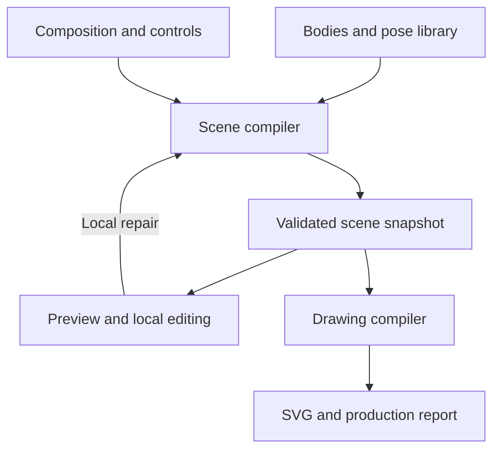

# Overpopulation beach plotter implementation plan

*Proof of concept for believable crowds and physical pen drawings*

18 November 2026

## 1 Purpose and recommended approach

Build an art tool that turns a three dimensional beach populated by hundreds or thousands of people into an intentional, physically drawable network of pen strokes. The artistic subject is the loss of personal space. At a distance, the people should form an almost continuous field; closer inspection should reveal ordinary beach activities made awkward by the presence of others.

The recommended implementation combines MPFB human assets, authored interaction groups, constrained local pose fitting, optional Rapier settling, and a dedicated vector exporter. Each accepted person has an actual posed body. Physics helps establish contact within small neighborhoods. The completed crowd is frozen for viewing and drawing.

The primary POC target is a convincing 1000 person composition. A 300 person drawing is the first full artistic checkpoint, and 3000 people is the scaling experiment. A small interaction patch must succeed before either large count is meaningful. These are proposed targets, not capabilities already demonstrated by an implementation.

The POC must establish three things together: the bodies remain believable when packed closely, the crowd expresses the theme, and the exported paths survive an actual pen on paper. A large shaded preview alone does not meet the goal.

### Working assumptions

- A desktop browser is the primary authoring environment. Generation and final export may be asynchronous.

- Blender and MPFB prepare the character and pose assets before they enter the browser.

- The first scene uses a flat or gently sloping beach, simple towels and a sparse shoreline.

- A high oblique orthographic camera is the initial final camera. Perspective can follow after the vector pipeline succeeds.

- The first print profile is A2 landscape with 20 mm margins and a nominal 0.25 mm pen. The actual machine, paper and ink will be calibrated through a test coupon.

- All timing, geometric budgets and tolerances below are starting hypotheses to validate during the POC.

## 2 Artistic requirements

The crowded beach should still feel inhabited. A bent knee takes the last available gap, an elbow has barely enough room to support its owner, and a towel is encroached on from several sides. Familiar behavior supplies the viewer with a scale for the crowding.

Use three complementary relationships. Physical contact means two surfaces meet within a controlled tolerance. Projected overlap means one body crosses another in the drawing with a clear front and back. Pose accommodation means a person changes a limb placement because another person occupies the neighboring space. The generator should represent these relationships explicitly.

Intertwining is successful when the viewer can follow the ownership of a limb through a congested region. Significant surface penetration, impossible joint rotation, an unsupported reclining torso, or an ambiguous junction that attaches an arm to the wrong person are failures.

### Composition at three scales

At the whole image scale, direct density with a painted field. Begin with a dense central field, a more compressed region, a narrow route toward the water and a few remaining pockets of sand. Crop some people at the frame boundary so the crowd seems to continue beyond the image. Keep the shoreline and a few beach objects recognizable without obscuring much of the population.

At group scale, vary head positions, body axes, posture height and the rhythm of bent limbs. Include a small number of distinct moments such as reading in a constrained space or reaching for a bag. Interactions must cross the boundaries of generated groups so the composition does not become repeated islands.

At individual scale, spend strokes on posture and body shape before faces. Interior detail should depend on projected size and local congestion. A figure partly hidden by neighbors may need fewer marks than an equally large exposed figure.

### Population accounting

Show requested population, valid placed population, in-frame population and population contributing exported strokes separately. Also report a diagnostic recognizability count based on visible head or meaningful torso and limb cues. Partial occlusion is expected; a hidden mesh must not count as a drawn person.

Set initial visibility and recognizability thresholds after approving the first dense patch. Do not optimize a crude count by adding tiny isolated marks. Review the per-person attribution overlay alongside the final drawing. For the 1000 person deliverable, the approved image must visibly communicate approximately that population rather than contain a large concealed reserve.

## 3 Paper scale and drawing language

A2 landscape measures 594 by 420 mm. With 20 mm margins, the drawable rectangle is 554 by 380 mm, or 210520 square millimetres. Dividing that area by population gives the following illustration of the available drawing space.

| **Population** | **Average area allocation** | **Equivalent square side** |
|----------------|-----------------------------|----------------------------|
| 300            | 701.7 square mm             | 26.5 mm                    |
| 1000           | 210.5 square mm             | 14.5 mm                    |
| 3000           | 70.2 square mm              | 8.4 mm                     |

These values are arithmetic allocations, not predicted body sizes or a proposal to arrange people on a grid. Overlap, body orientation and posture change the distribution. They explain why thousands of figures need highly selective interior marks or a larger sheet.

A head drawn 2 mm across is only eight nominal pen widths across with a 0.25 mm pen. Facial detail at that scale can obscure the shape. Start with body contours, selected self-occlusion contours, swimsuit boundaries, a few hair marks, towel outlines and a sparse shoreline. Add hatching only after those lines communicate the crowd.

| **Drawing parameter**         | **Initial setting**      | **Validation method**                       |
|-------------------------------|--------------------------|---------------------------------------------|
| Nominal pen width             | 0.25 mm                  | Measure actual ink spread on intended paper |
| Small intentional gaps        | 0.4 to 0.6 mm            | Plot dense crossings and adjacent limbs     |
| Curve simplification error    | At most 0.05 mm          | Compare protected and original contours     |
| Visibility boundary tolerance | At most 0.05 mm on paper | Inspect thin occluder fixtures              |
| Tiny optional fragment filter | 0.2 to 0.4 mm            | Exempt marks required to explain a pose     |
| Diagnostic raster sample      | 0.05 to 0.10 mm          | Use tiled diagnostics when necessary        |

These settings describe the proposed artwork, not guaranteed plotter precision. Use a 50 by 50 mm dense crop and a small line-spacing coupon to establish usable values. Judge proofs at actual size as well as enlarged on screen.

## 4 System architecture

Keep the scene compiler and drawing compiler independent. The scene compiler produces an immutable, validated collection of posed people. The drawing compiler reads that snapshot and produces attributed, visible strokes in paper coordinates. The interactive preview reads the same scene state.



*The validated scene is the shared boundary between interactive authoring and final drawing.*

| **Component**                | **Responsibility**                                | **Main output**                   |
|------------------------------|---------------------------------------------------|-----------------------------------|
| Asset preparation            | Bodies, skeleton mapping, surfaces and landmarks  | Versioned GLB and asset metadata  |
| Pose and interaction library | Valid pose families and small group relationships | Pose and motif definitions        |
| Scene compiler               | Placement, local fitting and validation           | Solved scene snapshot             |
| Preview renderer             | Inspect, pick and edit the crowd                  | Shaded, line and diagnostic views |
| Drawing compiler             | Contours, visibility and safe simplification      | Attributed stroke graph           |
| Plot export                  | Physical SVG, order and production estimates      | SVG and export report             |

Use TypeScript and Three.js for the browser application, with a conventional build system such as Vite. Use Rapier in a worker for the local collision and settling work where appropriate. Use typed arrays for geometry and joint data. A small custom projected-triangle index will support final line visibility. three-mesh-bvh is a candidate for spatial queries and geometry validation, not a complete contour exporter. [S4, S5, S8]

Keep the interface on the main thread. Put generation, validation, baking and line extraction into bounded worker jobs. Each job carries the scene revision and cancellation token. Discard results from obsolete revisions. A long export should show completed tiles or stages and remain cancellable.

### Proposed module boundaries

| **Module**  | **Contract**                                                    |
|-------------|-----------------------------------------------------------------|
| assets      | Load manifests and validate skeleton and geometry conventions   |
| poses       | Instantiate a pose or motif and expose permitted adjustments    |
| synthesis   | Propose placements and schedule overlapping solve neighborhoods |
| constraints | Enforce support, joint ranges, contact targets and clearance    |
| validation  | Return explicit per-person and per-region failures              |
| preview     | Display frozen batches and editable selected figures            |
| contours    | Bake surfaces and emit candidate curves with ownership          |
| visibility  | Split curves into visible intervals                             |
| strokes     | Protect junctions, simplify, attribute and order paths          |
| export      | Write SVG, scene snapshot and production report                 |

## 5 Human asset preparation

Use MPFB core assets as the starting point. MPFB provides parameterized human generation and automatic rigging, and its core graphical assets are CC0. The program source has a separate licence. Keep a manifest for every imported body, hair asset, garment and prop so any third-party terms remain identifiable. [S1]

Prepare six to eight body variants using a consistent skeleton convention. This is an initial art budget, not a requirement to create a new procedural anatomy system. Include variations in build and proportions that remain readable in outline. Avoid changing body dimensions during packing as a shortcut to making a failed placement fit.

Use the MPFB GameEngine rig or an equivalent reduced deformation rig. Its export guide recommends the GameEngine rig for external applications and discusses lower-resolution proxies and cleaning helper geometry. Preserve a separate editable Blender source for future asset work. [S2]

### Export and validation procedure

1. Normalize each body to metres and a documented up and forward convention. Use semantic bone names mapped to the exported rig rather than hard-coded indices.

2. Export the surface, inverse bind data, skin weights and required bones. Bake or remove Blender-only control logic. Keep runtime posing separate from Blender control rigs.

3. Prepare a coarse preview surface and a smoother export surface. Start around 2000 to 4000 triangles for preview and 4000 to 8000 for final geometry, then adjust from the silhouette proofs.

4. Build surface adjacency once per asset. Reconcile UV seam duplicates only when they are the same deforming surface. Do not weld separate garments, bodies or touching parts.

5. Store semantic landmarks at pelvis, shoulders, elbows, wrists, knees, ankles and support surfaces. Store authored feature curves against the final export topology using face indices and barycentric coordinates. Retain a correspondence or regenerate references when topology changes. Split curves at triangle boundaries so each emitted straight segment lies on its supporting posed triangle.

6. Create a physics profile with approximately 12 to 16 rigid segments. Fit capsules to limbs and simple convex envelopes to torso, pelvis, head, hands and feet as needed.

7. Render every approved pose on every body variant. Inspect shoulder and hip deformation, inverted triangles, surface intersections and support placement before admitting the asset to the library.

Collision proxies must cover the visible surface sufficiently for the intended pose range. A capsule entirely inside a limb can report clear space while the skin intersects a neighbor. Fit conservative envelopes, use a calibrated clearance margin, and add mesh-level validation of nearby pairs after fitting.

For the first release, represent swimwear mainly through simple surface boundaries or close-fitting geometry. Avoid cloth simulation and detailed fingers as dependencies of the crowd solver. Their visual value can be evaluated later at the actual print scale. Every visibility surface in this POC must be opaque geometry. Replace alpha-cutout hair cards with a simple opaque hair shape or authored line details, and exclude helper meshes from the occluder set. The preview and exporter must agree about which surfaces block a line.

## 6 Pose families and interaction motifs

Begin with roughly 12 to 16 solo poses across lying on the back, lying on the stomach, sitting, reclining and standing. Each pose has a semantic intent, support landmarks, allowable root motion, adjustable joints and conservative joint ranges. Variation stays within that pose family.

Build 8 to 12 authored motifs of two to six people. A motif stores relative placements and relationships, not only a frozen group transform. It must retain a coherent spatial story after changing bodies and nearby occupants.

| **Motif**                   | **Intended relationship**                | **Important constraints**                  |
|-----------------------------|------------------------------------------|--------------------------------------------|
| Offset reclining pair       | Knees use complementary gaps             | Preserve pelvis and elbow support          |
| Seated and lying pair       | Different posture heights overlap        | Keep each leg traceable and ground clear   |
| Three adjacent towels       | Rotated torsos and staggered heads       | Towels do not hide failed anatomy          |
| Conversation group          | Feet and knees share limited space       | Limit pose drift and preserve gaze intent  |
| Compressed route            | Standing figures fit among seated people | Maintain foot support and readable passage |
| Alternating reclining group | Body axes interleave across a region     | Vary silhouette and avoid repeated stripes |

Each motif should carry alternate limb placements, required supports, desired contacts, permitted close approaches, exclusions and maximum adjustment ranges. Author several internal variants before relying on random rotations. Mirror through a proper left-right rig mapping and regenerate normals and constraints; do not rely on negative scale to create a new body.

Store contact and support graphs separately. A contact edge records which body parts should touch or approach. A support edge records a load-bearing relationship to ground, prop or another body. Authored groups should be grounded through credible support chains. For the POC, admit inter-person support only where a motif explicitly defines and passes review for it.

Maintain a separate camera-dependent overlap record when a particular crossing is important to the drawing. Front and back ordering belongs to local surface crossings; it cannot be represented by a single whole-person drawing order.

## 7 Crowd synthesis and constrained fitting

Use physical space in metres and paper space in millimetres. Define a beach polygon, shoreline, exclusion regions, density field and orientation field. A density field expresses where crowding is desired. It does not override anatomical constraints or guarantee that any population can fit. Rapier recommends using sensible physical units. [S4]

### Stage A Place a conservative composition

Choose motif families from the posture mix and composition fields. Use coarse footprints and a spatial hash to find candidate neighborhoods. Allow footprint overlap where coarse height bands indicate that limbs can pass above or below one another. A flat occupancy mask must not reject every valid three dimensional interleave.

Place at moderate spacing first. Retain a stable person ID, motif ID and asset reference from the moment a candidate is created. Place a few focal groups deliberately, then fill and connect surrounding regions. Avoid a uniform grid or a repeating group sequence.

### Stage B Fit the selected bodies

Instantiate the selected body variants and fit each motif using root translation, yaw and bounded joint changes. Keep the chosen bone lengths fixed. Inverse kinematics preserves specified hand, elbow, foot and pelvis anchors. A change to body shape or support side triggers a complete local refit. Distinguish support contact from a fixed world-space anchor: approved ground contacts may slide tangentially during compaction while preserving contact height and posture. Only user-pinned anchors or specifically fixed authored contacts remain fixed in world space.

Start with a small damped iterative solver. Reduce broad conflicts through root translation and rotation before changing joints. Use analytic capsule distances for limb clearance and suitable convex queries for other proxies. Project joints back into their approved ranges after each iteration. Recompute support and contact errors before accepting a step.

The fitting objective penalizes deviation from the authored pose, missed desired contacts, density error, repeated neighboring silhouettes and loss of important visible cues. Nonpenetration, fixed bone lengths, required supports and approved joint ranges are acceptance constraints. Weighted costs alone must not permit violations of those conditions.

### Stage C Compress overlapping neighborhoods

Begin with active windows of roughly 8 to 32 people, a tunable initial budget. Include a halo at least as wide as the maximum reach relevant to the supported body set. Frozen neighbors provide collision boundaries while the core is adjusted. Move compression targets incrementally rather than starting from a mass of deep intersections.

After a pass, shift the solve windows and reopen boundaries. Add explicit relationships between neighboring motifs and resolve their shared spaces. Commit a person only when it and the neighbors affected by its changes pass validation. This prevents visible group seams and keeps local work from damaging already accepted contacts. Extend or reopen the neighborhood along required support and contact dependencies until its boundary can remain fixed. Report a dependency chain that exceeds the active budget rather than breaking a required relationship. Run parallel fits only when their neighborhoods, including halos and dependencies, are disjoint. Otherwise commit in a stable serial order against current state and revalidate the affected boundary.

### Stage D Apply optional controlled settling

Use Rapier only on an already plausible local pose. Set necessary supports and joint targets, simulate a bounded number of fixed steps, and reject excessive drift or failed contact. Its available joints and motors provide mechanisms for this, but they do not supply human intention or automatic balance. Anatomical shoulder swing and twist constraints need deliberate implementation. [S5]

Preserve the authored solution before settling. If dynamics make the contact less convincing or introduce intersections, retain or refit the constrained pose. Successful figures are baked and removed from the active dynamic set. A thousand final people need not remain a thousand active ragdolls.

### Stage E Validate and repair

Check broad proxy collisions during every solve. Before acceptance, examine nearby posed surface pairs and relevant self-intersections. Include ground clearance, required contact distances, joint ranges and support rules. Localize exemptions around legitimate joints and garment contact; disabling all self-collision is not acceptable. Run final acceptance on the final baked export surface, since coarse preview geometry can differ at contacts. Check containment as well as triangle intersections: a hand fully enclosed in a torso must fail even if no surface boundaries cross. Use inside/outside or signed-distance checks for suitably closed surfaces, with explicit policies for open garment geometry.

Support validation is a plausibility check. Foot or elbow anchors, conservative balance heuristics and authored support patterns are useful, but they do not establish full biomechanical equilibrium. Review the difficult groups visually from the intended camera and diagnostic side views.

If a patch fails, try another legal pose variation, move or rotate the group, enlarge the solve window, or backtrack the last placements. After a bounded retry budget, report the unresolved region and population shortfall. Offer a larger beach, a more compact posture mix or a different composition. Do not satisfy the requested count by penetrating, concealing or silently shrinking people.

### Generation control flow

```text
initialize scene fields and stable random streams
place focal groups and conservative candidate motifs
for each compression pass
    visit overlapping neighborhoods in a stable order
    fit roots then bounded joint adjustments
    preserve required supports and reject hard violations
    optionally settle a valid candidate with local physics
    validate surfaces and affected neighbor relationships
    commit accepted poses or backtrack and resample
repair relationships across motif and window boundaries
compute visible population and congestion diagnostics
save accepted poses and unresolved regions explicitly
```

## 8 Scaling and interactive editing

Use independent SkinnedMesh clones for individual editing and small groups. Three.js provides SkeletonUtils.clone to preserve bone associations when cloning a skinned hierarchy. Once a pose is accepted, bake the visible surface and render frozen bodies in spatial batches with a common material. [S3]

BatchedMesh supports different geometries with shared materials and can reduce draw calls. Native InstancedMesh is useful for repeated frozen geometry and props, but its ordinary shared-geometry model does not itself provide thousands of independent skeletal poses. Custom skeletal instancing is an optional later optimization. [S6]

Keep IDs and vertex or face ranges for each person inside a batch. When a person is edited, restore its editable representation and reopen its contact neighborhood. Rebuild only the affected batches. A 3D edit can change the visibility of more distant people behind it, so invalidate the affected projected region for line export too.

### Memory and work budgets

At 1000 bodies and 4000 to 8000 triangles per final body, the scene contains approximately 4 to 8 million triangles before props. At 3000 bodies that becomes 12 to 24 million. These products are planning arithmetic, not evidence of achieved performance.

Share source assets and adjacency. Retain final poses compactly and bake export geometry in bounded chunks. Avoid simultaneously retaining several full-resolution copies of the entire crowd. Process page tiles using every occluder whose projected bounds overlaps the tile, regardless of the location of its root.

Start with two heavy worker jobs at once and adjust from measurements. Transfer typed arrays deliberately; do not transfer buffers still needed by the preview. Keep a coarse preview representation resident and release export temporaries after each tile. Do not make shared memory or cross-origin isolation prerequisites for the first POC.

| **Proposed engineering target** | **Initial target to measure**                                     |
|---------------------------------|-------------------------------------------------------------------|
| Frozen 1000 body preview        | Approximately 30 frames per second at a declared viewport         |
| Generation and export           | Background jobs with progress and cancellation                    |
| 1000 body generation            | Investigate a 2 to 5 minute budget                                |
| 1000 body final export          | Investigate a 5 to 15 minute budget                               |
| Peak application memory         | Aim below 1.5 GB on the reference desktop                         |
| 3000 body case                  | Record time and memory before promising an interactive experience |

Choose and record the reference computer, browser, viewport and assets at the first benchmark. Missing one of these targets triggers profiling and an explicit scope decision. It must not trigger reduced anatomical validity or silent changes to population. Measure generation, mesh baking, spatial indexing, visibility, simplification and output writing separately. Report JavaScript and worker memory where measurable, estimated GPU buffers and the accounting method. Browser heap usage alone must not be labelled total application memory.

## 9 Drawing compiler and hidden line removal

The final exporter consumes an immutable scene snapshot. Bake current morph deformation and skeleton deformation into world-space triangles. Mesh.getVertexPosition includes the current morph and skinning state; its result is local and still needs the object world transform. StaticGeometryGenerator in three-mesh-bvh is another candidate for baking. Verify the chosen implementation against the rendered posed surface. [S7, S8]

### Candidate curves

Generate silhouette candidates from edges separating front-facing and back-facing triangles relative to the final camera. Add genuine surface boundaries and explicitly authored feature curves. Recompute facing on the posed surface and retain person, mesh, face and curve IDs. Keep self-occlusion candidates such as an arm crossing its owner's torso.

Do not export all triangle edges. EdgesGeometry selects edges using adjacent-face angles; that alone does not define smooth camera-dependent body contours. SVGRenderer is a general vector renderer, not the complete plotting pipeline described here. Bénard and Hertzmann provide a useful technical reference for contour extraction and visibility. [S9, S10]

Start with sufficiently smooth polygonal surfaces and conservative curve simplification. General suggestive contours, curvature-driven interior lines and artistic hatching are later additions. Each added line class must prove its value at final paper scale.

### Authoritative visibility algorithm

Use the orthographic camera to project each candidate 3D segment into paper coordinates. For every potentially overlapping projected triangle, clip the segment to the triangle footprint and compare their camera depths over that interval. Under orthographic projection, both depths vary linearly along the segment. Record the portion in which the triangle is closer, union all such hidden intervals and emit their complement.

```text
for each candidate segment
    hiddenIntervals = empty
    for each overlapping triangle from projected spatial index
        coveredInterval = clip segment to projected triangle
        hiddenIntervals += portion where triangle is closer
    visibleIntervals = subtract union of hiddenIntervals
    emit visible pieces with source and endpoint metadata
```

This is a geometric solution relative to the chosen triangulated surface, subject to numerical tolerance. It does not claim exact contours of an underlying smooth anatomical surface. Implement explicit handling for nearly edge-on triangles, equal-depth contact, degenerate segments and clipping boundaries. Keep paper-space position tolerances in millimetres separate from camera-depth equality tolerances in scene metres. Calibrate depth epsilon independently at grazing contacts; a large depth bias must not expose a feature curve that was generated below the skin.

Preserve self-occlusion. Suppress coincident hits from the incident faces of a source contour when appropriate; never ignore the entire owner body. Test intervals throughout a segment: a thin finger can hide its middle while both endpoints remain visible. At a contact, emit the visible front contour once rather than adding two arbitrary contact outlines.

### Fast preview and diagnostics

Use GPU depth, normal and person-ID passes for the live line preview, visibility estimates and problem overlays. Treat this preview as an approximation whose purpose is rapid editing. Compare the final vector result with the posed depth reference on difficult fixtures.

A full A2 diagnostic sampled at 0.05 mm would be 11080 by 7600 pixels, about 84 million pixels. Three four-byte buffers alone would require about 1 GB. Use bounded tiles; a 2048 square tile needs about 50 MB for those three buffers before overhead. The analytic final exporter avoids requiring a full-sheet high-resolution framebuffer.

### Tile correctness

Use one global camera and paper transform. Include all projected occluders overlapping a tile plus a halo for local processing. Assign output to tile cores deterministically and preserve curve identity across borders. Stitch only matching continuations. Test long foreground limbs, people with roots in other tiles and lines exactly on a tile boundary.

Use top-level body bounds and per-tile triangle indices to prune work. Stream completed stroke records and release temporary geometry. If exact interval clipping misses its time target, optimize indexing and geometry budgets first. An optional sampled-depth export must remain clearly identified as approximate and pass the same thin-occluder fixtures before it is used for production.

## 10 Stroke cleanup and physical SVG output

Keep a stroke graph before writing SVG. Each stroke records its owner, curve class, visible interval, protected endpoints and paper coordinates. Protect T-junctions, visibility breaks, narrow intentional gaps and the small cues that establish a hand, foot or head orientation.

Simplify within a paper-space error bound, initially 0.05 mm. Do not smooth across an occlusion endpoint. Revalidate changed paths against the visibility and clearance checks when they move near another surface. Avoid arbitrary wobble until a controlled line language is established.

Merge paths only when source identity, endpoint distance, tangent and visibility state agree. Global proximity merging can attach one person's arm to another body or redraw a deliberately removed gap. Remove duplicate coincident strokes using ownership and depth metadata rather than only their 2D distance.

Write an SVG with physical width and height in millimetres and a matching viewBox. Flatten required transforms and emit actual open or closed stroke paths and polylines with fill set to none. The drawing must not depend on white fills, masks, hidden paths, raster images or screen compositing to suppress unwanted ink. Crop path geometry to the print region explicitly.

Use semantic layers for body contours, selected detail and environment. With one pen, different SVG stroke widths do not automatically create different physical ink widths. The initial hierarchy should come from selective detail and spacing. Additional pens are a later, explicitly calibrated option.

vpype can help with path simplification, merging and travel sorting, but it does not know the semantic protections in this scene. Perform protected joining before generic optimization. Keep the original SVG, compare the optimized geometry, and reject any optimization that restores hidden lines or creates new anatomical connections. [S11]

### Plot duration estimate

Estimate duration from drawing length divided by effective drawing speed, travel length divided by travel speed, lift-cycle count multiplied by cycle time, and acceleration and handling overhead. Use measured effective speeds from the dense crop when available.

For illustration only, 150 metres of drawing at 30 mm per second takes about 83 minutes; 100 metres of travel at 80 mm per second takes about 21 minutes; and 10000 lift cycles at 0.2 seconds add about 33 minutes. That is roughly 2.3 hours before further overhead. These numbers are an example calculation, not a prediction for the user's machine.

Report drawing length, travel length, path count, lift count, estimated duration and the contribution of each line class. This makes excessive hatching or fragmentation visible before committing to a long print.

## 11 Artist workflow and controls

The default workflow is to choose paper and pen, choose population and posture mix, paint the density field, generate a composition, inspect and adjust problem groups, preview actual-size lines, then export the validated snapshot.

| **Control**           | **Intended artistic effect**                           |
|-----------------------|--------------------------------------------------------|
| Population target     | Sets the scale of the collective image                 |
| Crowding              | Reduces clearance within valid pose and contact limits |
| Density brush         | Concentrates or relieves pressure in selected areas    |
| Posture mix           | Balances lying, seated, reclining and standing figures |
| Gesture variation     | Changes tested variations within pose families         |
| Camera                | Adjusts packing visibility and layered overlap         |
| Interior detail       | Controls drawing density without changing population   |
| Paper and pen profile | Sets the physical feature budget                       |

Essential editing actions are select person, select group, rotate about a support point, lock pose, lock contact, lock region and regenerate neighborhood. Provide an isolate view to understand a confusing body. Preserve successful manual edits during seed comparisons.

Provide shaded, final-line and diagnostic views. Diagnostics should identify collisions, unsupported poses, required contacts, hidden people, congested junctions and unresolved regions. A failure message should explain which condition failed and offer a useful local action.

Keep numerical solver settings in an advanced panel. The artist should control the picture without needing to choose iteration counts or broad-phase data structures.

## 12 Scene data and reproducibility

Use a versioned scene snapshot as the boundary between authoring and drawing. Preserve semantic IDs through geometry batching and SVG generation. The minimum records are listed below.

| **Record**    | **Required information**                                                                                                  |
|---------------|---------------------------------------------------------------------------------------------------------------------------|
| Scene         | Schema version, seed, asset hashes, units, beach fields, camera and paper profile                                         |
| Person        | ID, body variant, root transform, final joint transforms, pose family, motif and state                                    |
| Relationship  | IDs, body parts, local anchors, near or touch or support type, support mode, allowed sliding, tolerance and required flag |
| Motif         | People, alternate limb configurations, adjustment bounds and support rules                                                |
| Curve         | Owner, surface reference, line class and protected landmarks                                                              |
| Stroke        | Curve ID, visible interval, paper points, endpoint reasons and layer                                                      |
| Export report | Snapshot hash, population counts, validation results, settings, timing and path statistics                                |

Save final poses as actual numerical transforms, not only instructions to regenerate them. Rapier documents deterministic JavaScript/WASM simulation under matching versions, initial state and construction order, with caveats about how initial numbers are calculated. The application adds its own ordering and floating-point choices. A seed alone is therefore insufficient as the archival contract. [S12]

Archive the solved scene, immutable asset versions, camera and paper settings, unoptimized stroke data and final SVG. Reopening a finished work should not rerun randomness or physics. Promise exact reproduction by replaying saved strokes; only claim identical regeneration after testing that narrower software and platform contract.

## 13 Validation and acceptance criteria

Every output marked ready to plot must pass the chosen geometric checks for every placed person. Automated checks should enumerate failures rather than hide them in an aggregate score. Human review then assesses posture credibility, ownership of limbs and the composition at print size.

### Small fixtures before population tests

1. One morphed and bent body proves that export uses the posed surface.

2. An arm crossing its owner's torso proves self-occlusion.

3. Interleaved forearms from two people prove front and back junctions.

4. A thin foreground finger crossing the middle of a long segment proves interval clipping.

5. Near-contact and near-tangent surfaces expose dotted or doubled contours.

6. A figure and towel crossing a tile border expose missing occluders and stitching errors.

7. The same scene exported at A3 and A2 proves that tolerances are measured in millimetres.

8. An edited figure in front of another group proves correct visibility invalidation.

9. An optimized SVG proves that cleanup preserves gaps and topology.

10. A physical dense crop proves usable ink separation and contour readability.

### Acceptance matrix

| **Area**              | **Required evidence**                                                                     |
|-----------------------|-------------------------------------------------------------------------------------------|
| Asset quality         | Every supported pose family checked on every admitted body variant                        |
| Anatomy and clearance | No unresolved nonexempt penetration or joint-limit failure above the documented tolerance |
| Support               | Required anchors and authored support rules hold; difficult groups reviewed               |
| Population            | Requested, valid, in-frame and visibly contributing counts reported                       |
| Drawing topology      | Hidden intervals removed and protected junctions preserved                                |
| Print scale           | Dense actual-size crop remains readable on the intended pen and paper                     |
| Diversity             | Whole image and crops do not expose conspicuous motif stamps                              |
| Stability             | Local edits preserve locked regions and repair affected contacts                          |
| Performance           | Timings and peak memory measured on the named reference system                            |
| Archival replay       | Saved snapshot and final strokes reopen without rerunning generation                      |

Treat hard geometry checks separately from diagnostic art scores. Track pose-family frequency, local clearance, visible contour length, projected head size, crowded junctions, tiny-gap frequency and repeated silhouettes. Calibrate their thresholds with approved prints rather than assigning unsupported universal limits.

For the 1000 person checkpoint, use at least three materially different seeds and two density maps. Review every automatically flagged region, a stratified sample of unflagged figures, the whole composition and actual-size difficult crops. Automated validation still covers all placed bodies. Manual sampling supports artistic review; it does not certify every aspect of biomechanics.

## 14 Implementation sequence and effort

Advance by evidence. A large population test should use the same drawing pipeline that passed the small interaction test. Avoid deferring the pen output until after the crowd system is complete.

| **Milestone**          | **Deliverable**                         | **Exit condition**                                   | **Planning effort**   |
|------------------------|-----------------------------------------|------------------------------------------------------|-----------------------|
| A Body and pen proof   | One MPFB body in five beach poses       | Convincing contours on a physical crop               | 3 to 5 developer days |
| B Difficult group      | 12 to 30 people using several motifs    | Contact, support and hidden-line fixtures pass       | 6 to 10 days          |
| C Complete composition | Approximately 300 people                | Density, diversity and drawing language approved     | 6 to 9 days           |
| D Primary POC          | 1000 valid people and complete SVG      | Multiple compositions pass geometry and print review | 6 to 10 days          |
| E Production proof     | Calibrated full print and export report | Reliable replay and practical path budget            | 3 to 5 days           |
| F Scaling experiment   | 3000 person scene and export            | Measured memory, duration and paper readability      | 3 to 6 days           |

The total is approximately 27 to 45 developer days for an experienced graphics developer, plus roughly 5 to 10 days of technical art work that can partly overlap. This is a planning estimate. Revise it after the difficult-group milestone, when the actual contour quality and fitting difficulty are known.

### First implementation tasks

Start with the asset manifest and canonical skeleton mapping. Prepare one body and five poses, then build the posed-mesh snapshot and orthographic camera. Implement contour candidates and the minimal hidden-interval solver before a full editor. Add the crossed-arm and thin-occluder fixtures, produce a dense physical crop, and tune the paper-space tolerances.

Next author three difficult interaction motifs, define their support and contact records, and implement bounded local fitting. Only after that patch is convincing should the project add painted density fields, overlapping neighborhood passes and large population benchmarks.

### Scope decisions if a gate fails

If anatomy fails, improve the pose library, support rules or mesh deformation before raising population. If contacts fail, fit more conservatively and improve the local solver before adding stronger physics. If silhouettes fail, improve source geometry and protected simplification before adding interior lines. If the 3000 person print becomes unreadable, increase paper size or reduce optional detail while preserving valid bodies and honest population accounting.

If asynchronous browser export exceeds the agreed memory or time budget after profiling, consider an optional desktop or server export worker consuming the same saved scene format. Keep that as an explicit implementation decision, with the local browser path still producing valid smaller proofs.

## 15 Final POC deliverables

The finished POC should include an editor for the crowded beach, the versioned body and pose library, the interaction motifs, the small visibility and collision fixtures, and saved 300 and 1000 person compositions. Include a measured 3000 person experiment with a clear statement of any remaining limit.

For each approved artwork, produce the editable scene snapshot, the final SVG in millimetres, a preview of that exact SVG and a production report. Keep asset references and licences alongside the project. Supply the actual-size crop results and at least one full physical print when plotter access is available.

The first convincing deliverable is a small patch where the bodies visibly accommodate one another and the pen lines remain clear at contact. That patch establishes the visual language and the technical representation that the thousand-person composition will expand.

## Source references

The engineering architecture, artistic requirements, target counts, effort estimates and numeric budgets in this plan are proposed design decisions. The sources below support the stated capabilities and relevant technical background. Sources were checked on 18 November 2026.

[S1] MakeHuman Community. About MPFB and asset licensing. <https://static.makehumancommunity.org/mpfb/about.html> ; <https://static.makehumancommunity.org/about/license.html> ; <https://static.makehumancommunity.org/mpfb/faq/can_i_sell_models.html>

[S2] MakeHuman Community. Exporting MPFB characters. <https://static.makehumancommunity.org/mpfb/docs/exporting/index.html>

[S3] Three.js. SkinnedMesh, GLTFLoader and SkeletonUtils. <https://threejs.org/docs/pages/SkinnedMesh.html> ; <https://threejs.org/docs/pages/GLTFLoader.html> ; <https://threejs.org/docs/pages/module-SkeletonUtils.html>

[S4] Rapier. Colliders, scene queries and common mistakes. <https://rapier.rs/docs/user_guides/javascript/colliders/> ; <https://rapier.rs/docs/user_guides/javascript/scene_queries/> ; <https://rapier.rs/docs/user_guides/javascript/common_mistakes/>

[S5] Rapier. Joints and spherical joint API. <https://rapier.rs/docs/user_guides/javascript/joints/> ; <https://rapier.rs/javascript3d/classes/SphericalImpulseJoint.html>

[S6] Three.js. BatchedMesh and InstancedMesh. <https://threejs.org/docs/pages/BatchedMesh.html> ; <https://threejs.org/docs/pages/InstancedMesh.html>

[S7] Three.js. Mesh getVertexPosition. <https://threejs.org/docs/pages/Mesh.html>

[S8] Garrett Johnson. three-mesh-bvh repository and API. <https://github.com/gkjohnson/three-mesh-bvh> ; <https://github.com/gkjohnson/three-mesh-bvh/blob/master/API.md>

[S9] Three.js. EdgesGeometry and SVGRenderer. <https://threejs.org/docs/pages/EdgesGeometry.html> ; <https://threejs.org/docs/pages/SVGRenderer.html>

[S10] Pierre Benard and Aaron Hertzmann. Line Drawings from 3D Models. 2019. <https://arxiv.org/abs/1810.01175>

[S11] vpype. CLI reference and fundamentals. <https://vpype.readthedocs.io/en/latest/reference.html> ; <https://vpype.readthedocs.io/en/latest/fundamentals.html>

[S12] Rapier. Determinism. <https://rapier.rs/docs/user_guides/javascript/determinism/>
