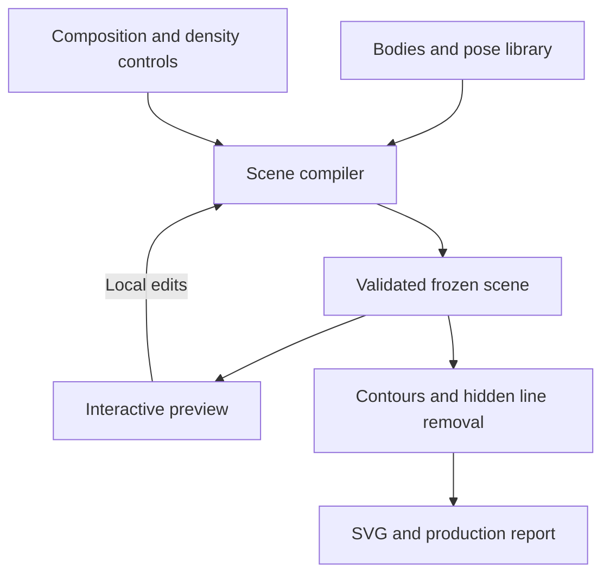

I’ve written a **15-page implementation plan**, with a **1,000-person artwork as the primary POC target** and a **3,000-person scaling experiment**.

Plan: overpopulation-beach-plan.md

The central design decision is to **build the crowd from small groups of deliberately interacting people, adapt those groups through constrained posing, and use physics locally to improve contact**. Each accepted body then becomes part of a frozen scene from which we generate the pen paths.

That gives us a practical route to thousands of believable figures while preserving control over the picture. The difficult work is making the interactions convincing and ensuring that their meaning survives conversion into lines.

# 1. Define success through the artwork

For the overpopulation theme, I would make **the loss of personal space** the organizing idea.

From a distance, the beach should read as an almost continuous human surface. At closer range, the viewer should discover recognizable activities: someone reading with their elbows tucked in, a knee occupying the last gap, a reclining person whose supporting arm fits awkwardly between two neighbors.

The scene needs three kinds of relationship:

| Relationship | What it contributes |
|---|---|
| **Physical contact** | Bodies appear close enough to touch, with plausible surfaces and contact points. |
| **Projected overlap** | Limbs cross in the drawing with a clear front and back. |
| **Pose accommodation** | A person bends, turns, or relocates a limb because a neighbor occupies the available space. |

The third is especially important. It gives the crowd human intention.

“Intertwined” should mean that these relationships are tightly connected throughout the scene. Every accepted person must still have valid anatomy and a credible pose. We should be able to isolate any figure and understand how its limbs connect, even if only parts of it are visible in the final drawing.

### Proposed population milestones

- **12–30 people:** prove difficult interactions and the drawing language.
- **300 people:** prove a complete composition, variation, and density.
- **1,000 people:** the main POC acceptance target.
- **3,000 people:** establish the software and paper-scale limits.

These are development targets, not performance already demonstrated.

The app should report **requested population, valid placed population, and visibly contributing population** separately. Adding hidden bodies must not inflate the claim that the artwork depicts a thousand people.

# 2. Separate scene generation from drawing generation

I would use two main systems:

1. A **scene compiler** that produces validated, posed bodies.
2. A **drawing compiler** that turns the frozen scene into visible pen strokes.

The preview and exporter should consume the same saved scene.

The initial stack would be:

| Part | Recommended approach |
|---|---|
| Body and pose preparation | Blender with MPFB |
| Browser application | TypeScript and Three.js |
| Pose fitting | Custom bounded pose solver and inverse kinematics |
| Collision queries and optional settling | Rapier |
| Geometry acceleration | Spatial hashes and triangle indices; evaluate `three-mesh-bvh` |
| Interactive drawing preview | GPU depth, normal, and person-ID passes |
| Final drawing | Geometric contour extraction and hidden-line removal |
| Output | SVG in millimetres, saved scene, and plot report |

Heavy generation and export jobs should run in workers, with progress and cancellation. The artist should be able to inspect the current scene while a higher-quality export is being prepared.

# 3. Prepare a small, dependable human asset library

MPFB remains the recommended starting point. It provides parameterized human generation and automatic rigging, and its core graphical assets are CC0. Third-party additions need their own licence records. [static.makehumancommunity.org](https://static.makehumancommunity.org/mpfb/about.html?utm_source=chatgpt.com)

For the POC, I would prepare **six to eight body variants** with a consistent skeleton convention. Their differences should be visible through outline: build, torso shape, limb proportions, and posture.

### Asset preparation steps

1. **Normalize dimensions and orientation.** Use metres for the physical scene and document the up and forward axes.
2. **Create a semantic skeleton mapping.** The application should address “left elbow” or “pelvis,” rather than depend on arbitrary bone indices.
3. **Prepare two surface resolutions.** Start around 2,000–4,000 triangles for preview and 4,000–8,000 for final drawing geometry, then adjust according to actual silhouette quality.
4. **Export clean deformation data.** Keep Blender control logic separate from the skeleton used by the app.
5. **Store landmarks and feature curves.** Include support points, swimsuit boundaries, and selected hair or facial marks.
6. **Build a collision profile.** Use approximately 12–16 simplified rigid segments per person as a starting point.
7. **Validate every pose family on every admitted body variant.**

MPFB’s export guide recommends its GameEngine rig for external applications and discusses lower-resolution proxies and removal of helper geometry. That is the preparation route I would follow. [static.makehumancommunity.org](https://static.makehumancommunity.org/mpfb/docs/exporting/index.html?utm_source=chatgpt.com)

The collision representation and visible surface need to agree. A capsule fitted inside a limb can be collision-free while the skin intersects a neighbor. We therefore need conservative collision envelopes during fitting and a final check against the actual export surface.

For the first POC, I would use **opaque hair shapes and simple swimwear boundaries**. Transparent hair cards would complicate geometric visibility: their triangles could conceal body lines through areas that look transparent in the preview.

# 4. Author interaction groups before generating the crowd

This is the most important part of the generation strategy.

A collection of independently randomized poses will rarely produce convincing intertwining. We need a vocabulary of relationships that already make sense, then a system that adapts them to their surroundings.

I would start with:

- **12–16 solo poses** across lying, sitting, reclining, and standing.
- **8–12 interaction motifs**, each containing roughly two to six people.
- Several legal variations within each motif.

Examples:

| Motif | Spatial idea | What must remain valid |
|---|---|---|
| Offset reclining pair | Bent knees occupy complementary gaps | Pelvis and elbow supports |
| Seated and lying pair | Different posture heights create overlap | Leg ownership and ground clearance |
| Adjacent towels | Staggered heads and rotated torsos | Natural spacing and readable contours |
| Conversation group | Feet and knees share limited space | Pose intent and plausible supports |
| Compressed passage | Standing figures occupy gaps among seated people | Foot placement and a recognizable route |
| Alternating reclining group | Body axes interleave across a larger region | Variation without obvious stripes |

A motif should contain more than positions. It should specify:

- Which joints may move.
- Which support points must remain in contact.
- Which body parts should approach or touch.
- Which alternative limb arrangements are allowed.
- How far roots may move or rotate.
- Which local front/back relationships matter to the drawing.

For example, a reclining pose could preserve its pelvis and forearm contact while allowing the free knee to move into a neighboring gap.

### Distinguish contact from fixed anchors

A hand resting on the sand may be allowed to slide along the ground during packing. A user-pinned hand should stay at its exact world position.

Those are different constraints. Treating every support as a fixed coordinate would make the packing solver unnecessarily rigid.

### Connect neighboring motifs

After placing groups, the generator needs a separate pass that introduces and repairs relationships **across group boundaries**.

Otherwise, even a large crowd can reveal repeated islands: convincing groups surrounded by suspiciously regular gaps. The final composition should feel continuous.

# 5. Generate density through controlled local fitting

The crowd generator should build density progressively.

## Step A — Establish the composition

Define:

- The usable beach polygon.
- Shoreline and exclusion regions.
- A painted density field.
- A broad orientation field.
- The posture mix.
- A few deliberately positioned focal groups.

The density field determines where pressure is strongest. The orientation field creates a rhythm without imposing a grid.

Start at moderate spacing. Coarse footprints and a spatial hash can identify candidate neighbors quickly. Keep approximate height information so that a raised limb can pass over a lower body part; a purely flat occupancy mask would reject valid arrangements.

## Step B — Fit the chosen bodies

Instantiate body variants inside each motif and adjust:

- Root position.
- Root yaw.
- A limited set of joint rotations.
- Allowed support positions.

Keep each body’s bone lengths fixed.

Use inverse kinematics to preserve important contacts. Resolve large conflicts through translation and rotation first, then make smaller limb adjustments.

The fitting objective can balance:

- Closeness to the authored pose.
- Desired contact positions.
- Local density.
- Neighboring silhouette diversity.
- Visibility of important body cues.

**Anatomical validity, required supports, and nonpenetration are acceptance constraints.** The solver must not trade them away to gain a better density score.

## Step C — Compress overlapping neighborhoods

Start with approximately **8–32 active people per solve window**, treating that as a tunable budget.

Each window has a core and a surrounding neighborhood. Nearby accepted bodies act as boundaries. After one pass, shift the windows and repair the shared regions.

A required contact or support chain can extend beyond a simple geometric radius. The solver must reopen the relevant dependencies or report that it cannot resolve the region within its budget.

Parallel fitting is safe only when the affected neighborhoods are disjoint. Otherwise, commit changes in a stable order and revalidate the shared boundary.

## Step D — Use physics for controlled settling

Rapier provides collision shapes, joints, and motors that can move joints toward targets. Those are useful mechanisms for local settling, but the application still has to define the intended posture and anatomical restrictions. [rapier.rs](https://rapier.rs/docs/user_guides/javascript/colliders/?utm_source=chatgpt.com)

The process would be:

1. Begin from a plausible, minimally intersecting arrangement.
2. Preserve the necessary supports and pose targets.
3. Run a bounded number of fixed simulation steps.
4. Reject excessive drift, broken supports, or unresolved intersections.
5. Bake accepted transforms.

The pre-settling pose should remain available. Physics is useful only when it improves the result.

## Step E — Validate and repair

During fitting, use simplified shapes. Before accepting the result, validate the final posed export geometry.

Checks should cover:

- Body/body and body/ground intersections.
- Relevant self-intersections.
- Joint ranges.
- Required contact distances.
- Support relationships.
- Containment, such as a hand entirely inside a torso.

Containment matters because triangle boundary tests alone can miss a fully enclosed body part.

If a region fails, try another legal pose variation, reposition the group, enlarge the solve window, or backtrack. If it still cannot fit, report a population shortfall and the affected region.

There is no physically valid way to satisfy every possible combination of beach area, population, and posture mix. The app needs an honest failure state.

# 6. Scale by freezing completed work

The final artwork is static. We can use that fact throughout the implementation.

During editing, use independent skinned bodies. Three.js provides `SkeletonUtils.clone()` for cloning a skinned hierarchy while maintaining the association between meshes and bones. [threejs.org](https://threejs.org/docs/pages/module-SkeletonUtils.html?utm_source=chatgpt.com)

Once a pose is accepted:

- Bake its deformation.
- Put its surface into a spatial render batch.
- Preserve its person ID and geometry ranges.
- Remove its active dynamic representation.
- Restore an editable representation only when needed.

Three.js `BatchedMesh` supports different geometries sharing materials and can reduce draw calls. Ordinary `InstancedMesh` is most useful where geometry is shared, such as repeated props or identical frozen poses; independent skeletal animation would require additional work. [Three.js Docs](https://threejs.org/docs/pages/BatchedMesh.html?utm_source=chatgpt.com)

### Geometry budgets

With the proposed final surfaces:

- **1,000 people:** approximately 4–8 million triangles before props.
- **3,000 people:** approximately 12–24 million triangles.

These are arithmetic budgets, not performance claims.

The exporter should reconstruct geometry in bounded chunks rather than retain several complete high-resolution copies of the scene.

Initial engineering targets could be:

| Operation | Target to investigate |
|---|---|
| Frozen 1,000-person preview | Around 30 fps at a declared viewport |
| 1,000-person generation | A few minutes in a background job |
| Final 1,000-person SVG export | Approximately 5–15 minutes |
| Memory | Aim below 1.5 GB on a named reference desktop |
| 3,000-person case | Measure before promising interactive performance |

The benchmark must identify the computer, browser, viewport, and assets. Memory reporting should distinguish JavaScript and worker memory from estimated GPU allocations.

# 7. Build the line exporter early

The line exporter should be part of the first prototype. Every important pose needs to be judged through its drawing.

## Freeze the exact posed surface

Export must consume an immutable snapshot containing the final body transforms, camera, and print settings.

Three.js’s `Mesh.getVertexPosition()` accounts for morph targets and skinning. Its result is local to the mesh, so the exporter must also apply the world transform. `three-mesh-bvh` offers `StaticGeometryGenerator` as another route for baking skinned and morphed geometry. [Three.js Docs](https://threejs.org/docs/pages/Mesh.html?utm_source=chatgpt.com)

## Use a limited line vocabulary

The initial drawing should include:

1. Body silhouettes.
2. Selected self-occlusion contours.
3. A few authored details, such as swimsuit edges and hair marks.
4. Towels and sparse environmental lines.

We should not extract every mesh edge. `EdgesGeometry` uses angles between neighboring faces, which does not by itself produce the camera-dependent outline of a smooth body. [threejs.org](https://threejs.org/docs/pages/EdgesGeometry.html?utm_source=chatgpt.com)

Authored detail curves must remain on the final surface. Store them against the export topology and split them at triangle boundaries. Otherwise, a straight chord between surface points can pass inside the body and disappear under correct visibility testing.

## Use an orthographic final camera for the POC

A high oblique orthographic view gives the composition a flattened, diagrammatic quality while preserving meaningful overlap.

It also simplifies the final visibility calculation.

For each candidate line segment:

1. Project it into paper coordinates.
2. Find triangles whose projected bounds overlap it.
3. Clip the segment against each triangle’s projected footprint.
4. Compare their depths over the covered interval.
5. Collect the intervals hidden by nearer surfaces.
6. Emit only the remaining visible pieces.

Under orthographic projection, the necessary depth comparisons along a segment are linear.

This is a proposed geometric implementation relative to the chosen polygonal surface, with explicit numerical tolerances. It is not a claim that Three.js already provides this complete exporter. Bénard and Hertzmann’s contour-rendering tutorial is a useful reference for the distinction between extracting contours and determining their visibility. [arxiv.org](https://arxiv.org/abs/1810.01175?utm_source=chatgpt.com)

### Preserve self-occlusion and local depth order

An arm can pass in front of its own torso and behind another person’s knee. We cannot give each whole person one global drawing order.

The exporter must keep self-occlusion enabled and resolve visibility along each curve.

A particularly useful test is a thin foreground finger crossing the middle of a long line. Both endpoints can remain visible while the middle is hidden. An endpoint-only visibility test would fail.

## Tile the export correctly

Process the paper in tiles, but include **every occluder whose projected bounds overlaps the tile**. The root of that person may be elsewhere.

Use global camera coordinates, deterministic ownership of tile borders, and persistent curve IDs. Preserve matching continuations across tiles.

GPU depth, normal, and ID passes remain useful for fast preview and diagnostics. The authoritative SVG should come from the validated visibility pipeline.

# 8. Make the paths safe for a physical pen

A screen can hide one line behind a white polygon. A physical pen cannot undo an earlier stroke.

The final SVG therefore needs actual clipped paths. It should not rely on masks, white fills, hidden geometry, or raster images to conceal lines.

Before writing SVG, maintain a stroke representation that records:

- Person and curve ownership.
- Line class.
- Visible interval.
- Paper coordinates.
- Protected endpoints.
- Why a path ends, such as an occlusion boundary.

This metadata is valuable when simplifying and joining lines.

### Protect the meaningful junctions

Preserve:

- T-junctions that explain front and back.
- Narrow gaps between neighboring limbs.
- Small hand or foot cues that establish a pose.
- Head and neck connections.
- Intentional breaks caused by occlusion.

Merge paths only when their identity, direction, visibility state, and endpoints agree. Joining everything within a distance threshold can attach a limb to the wrong person.

`vpype` offers simplification, merging, and travel sorting, but it does not know these body relationships. I would use it after semantic cleanup and compare the result against the original paths. [vpype documentation](https://vpype.readthedocs.io/en/latest/reference.html?utm_source=chatgpt.com)

Write the SVG with physical dimensions in millimetres, a matching `viewBox`, and open or closed stroke paths with `fill="none"`.

With one pen, different SVG stroke widths do not automatically create different physical line widths. The initial visual hierarchy should come from the choice and spacing of lines.

# 9. Treat paper size as a population constraint

I would begin with **A2 landscape, 20 mm margins, and a nominal 0.25 mm pen**.

That provides a drawable area of 554 × 380 mm.

Dividing this area by population gives:

| Population | Average area per person | Equivalent square side |
|---|---:|---:|
| 300 | 701.7 mm² | 26.5 mm |
| 1,000 | 210.5 mm² | 14.5 mm |
| 3,000 | 70.2 mm² | 8.4 mm |

These are illustrative allocations, not predicted body dimensions. They show why the drawing language must become more selective as population rises.

A 2 mm head drawn with a 0.25 mm pen is only eight nominal pen widths across. Elaborate facial detail at that size is unlikely to help.

For the first proofs, I would test:

- Intentional gaps around **0.4–0.6 mm**.
- Simplification error up to **0.05 mm**.
- Very short optional fragments around **0.2–0.4 mm**, with exceptions for meaningful features.
- A **50 × 50 mm dense crop** containing several difficult overlaps.

These are initial settings to calibrate with the actual machine and paper.

At 3,000 people, we may need a larger sheet or substantially less interior detail. Every body can still have a fully specified pose even when only a few carefully selected strokes represent it.

### Estimate plotting time from the paths

The production report should include drawing length, travel length, lift count, and an estimated duration.

As an illustrative calculation:

- 150 m of drawing at 30 mm/s: about 83 minutes.
- 100 m of travel at 80 mm/s: about 21 minutes.
- 10,000 lift cycles at 0.2 seconds: about 33 minutes.

That is approximately **2.3 hours before further overhead**. The real estimate must use measured effective speeds; small strokes can spend much of their time accelerating and lifting.

# 10. Give the artist control over the composition

The main controls should describe the picture:

| Control | Purpose |
|---|---|
| Population | Sets the intended scale of the crowd |
| Crowding | Reduces clearance within valid pose limits |
| Density brush | Concentrates or relieves pressure locally |
| Posture mix | Balances lying, seated, reclining, and standing bodies |
| Gesture variation | Varies tested arrangements |
| Camera | Controls packing visibility and overlap |
| Interior detail | Changes stroke density without changing population |
| Paper and pen | Sets the physical feature budget |

Essential editing actions are:

- Select a person or interaction group.
- Rotate around a support point.
- Lock a pose, contact, or region.
- Regenerate a neighborhood.
- Isolate a confusing body.
- Compare seeds while preserving manual edits.

Provide three views: shaded geometry, final lines, and diagnostics.

The diagnostic view should identify intersections, missing supports, hidden people, congested junctions, and unresolved regions. Numerical solver settings can remain in an advanced panel.

# 11. Save the artwork as a reproducible scene

A seed is useful for exploration, but the finished work needs a stronger record.

Save:

- Exact asset versions and hashes.
- Final root and joint transforms.
- Pose and interaction IDs.
- Support and contact relationships.
- Camera and page settings.
- Export tolerances.
- Attributed stroke data.
- Final SVG and production statistics.

Rapier documents deterministic JavaScript/WASM behavior under matching versions, initial state, and construction order, with caveats about numeric initialization. The application introduces additional choices, so I would archive the actual solved poses and strokes. [Rapier](https://rapier.rs/docs/user_guides/javascript/determinism/?utm_source=chatgpt.com)

Reopening a completed artwork should not require rerunning randomness or physics.

# 12. Implement through concrete acceptance gates

The build sequence should be driven by visible evidence.

| Milestone | Deliverable | Acceptance condition |
|---|---|---|
| **A — Body and pen proof** | One MPFB body in five beach poses | Convincing contours in an actual-size physical crop |
| **B — Difficult group** | 12–30 interacting people | Plausible supports, clear limb ownership, correct hidden lines |
| **C — Complete composition** | Approximately 300 people | Density and variation work across the whole image |
| **D — Primary POC** | 1,000 people and a complete SVG | Multiple compositions pass geometry and drawing review |
| **E — Production proof** | Calibrated full print and report | Practical stroke budget and reliable replay |
| **F — Scaling experiment** | 3,000-person scene and export | Measured time, memory, and paper readability |

Before the large scenes, build explicit fixtures for:

- An arm crossing its own torso.
- Interleaved limbs from different people.
- A thin occluder hiding the middle of a line.
- Near-contact surfaces.
- A person and towel crossing an export-tile boundary.
- A foreground edit that changes another person’s visibility.
- The same composition at two paper sizes.
- Optimized paths that must preserve intentional gaps.

For the 1,000-person gate, use at least **three substantially different seeds and two density maps**. Automated validation should cover every placed body. Human review should cover all flagged regions, a stratified sample of unflagged figures, the whole image, and difficult actual-size crops.

A realistic planning allowance is approximately **27–45 developer days for an experienced graphics developer**, plus **5–10 days of technical art work**, some of which can overlap. The detailed document breaks that down by milestone. I would revise the estimate after the difficult-group stage, when we know how well the body deformation, contact fitting, and line extraction work together.

**The first implementation should produce a small, tightly intertwined patch with clean physical pen output.** That patch will determine the pose representation, contact rules, contour quality, and drawing language that the thousand-person scene expands.